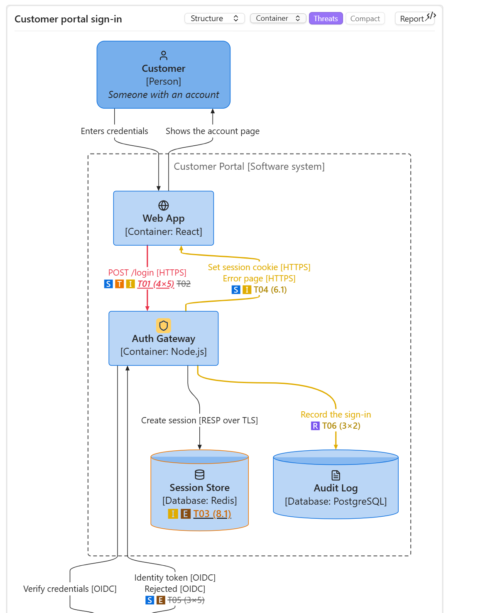
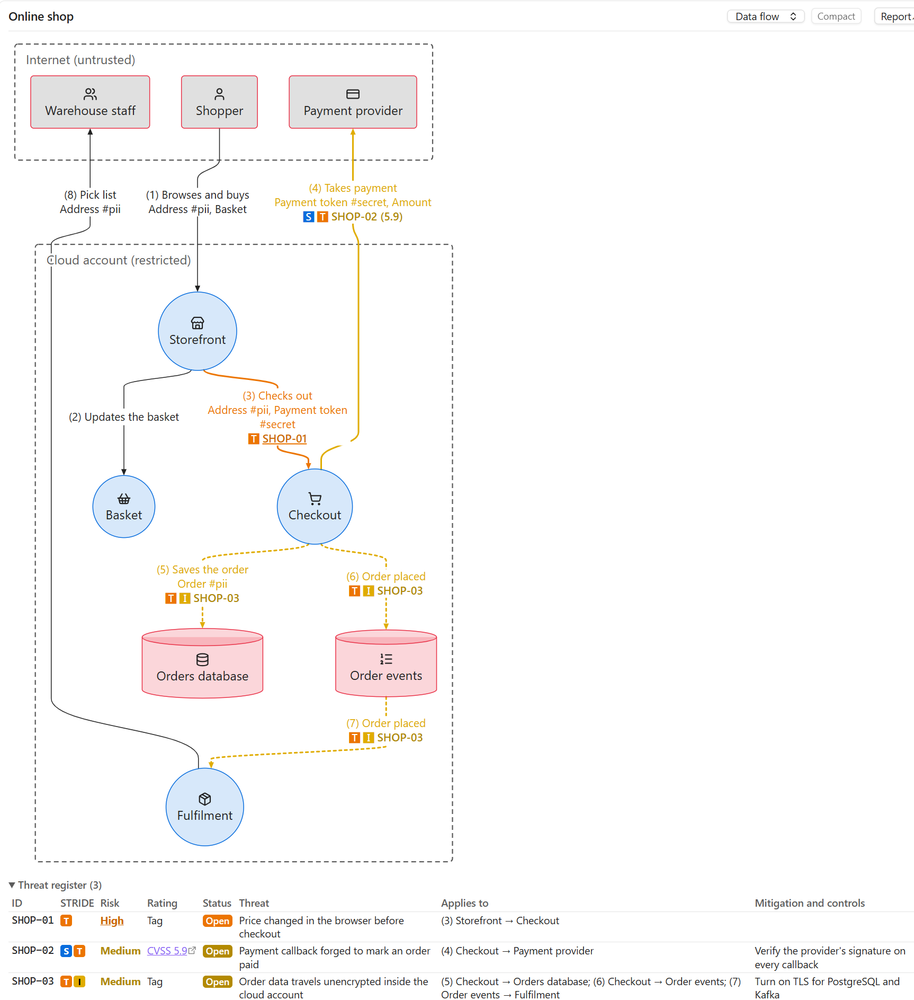
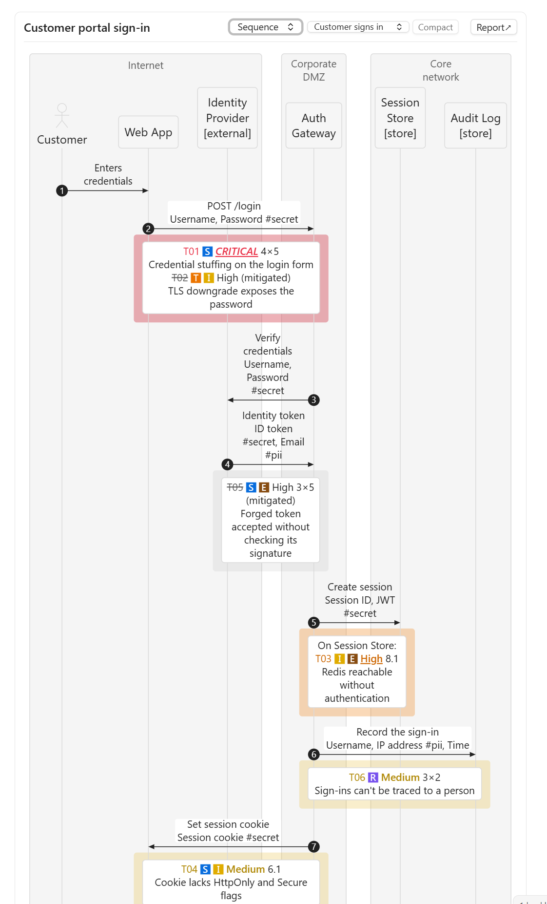
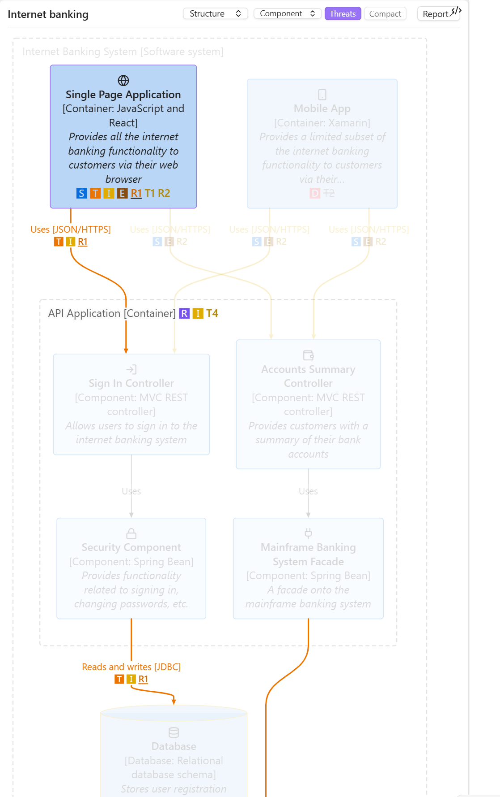
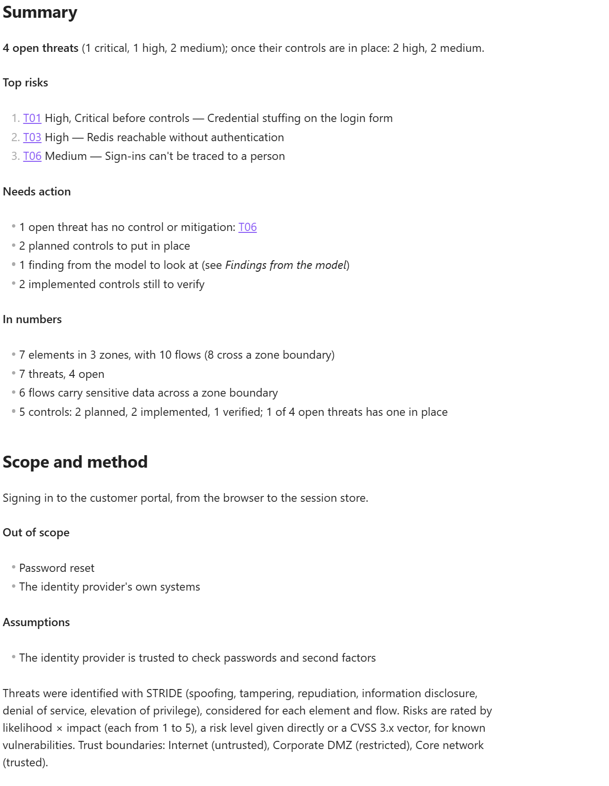
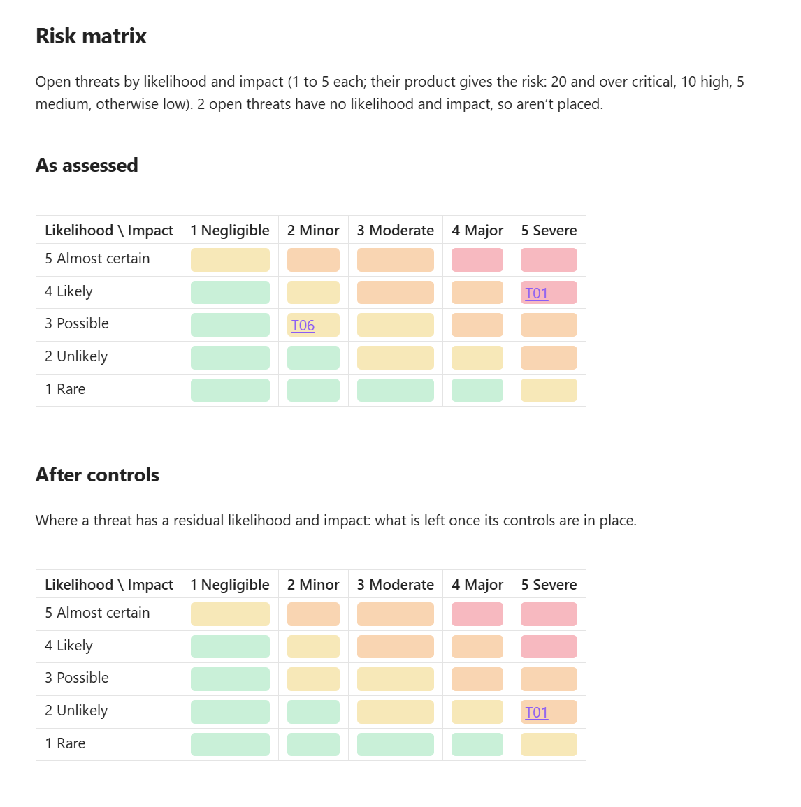
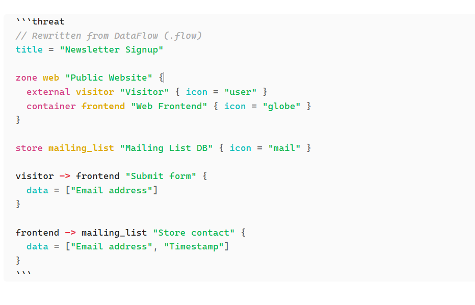

# Threat Modelling

An Obsidian plugin for writing threat models in your notes. You describe a system in a `threat` code block: its people, systems, containers and data stores, the trust zones they run in, the data that flows between them, and the threats to each part. The plugin draws the model three ways, writes a report of it as a note when you ask, and checks it as you write.

It works on desktop and mobile, and it is completely local: diagrams are drawn by Obsidian's own Mermaid renderer, [Pele](https://pele.run/), so it needs Obsidian 1.15 or later.

> [!NOTE]
> **0.2.0:** default icons, marks for untrusted zones and sensitive data, and the old `.flow` words (`io`, `function`, `database`, `boundary`) are gone. See [the release notes](docs/release-notes/0.2.0.md).
>
> **0.1.0:** first release. See [the release notes](docs/release-notes/0.1.0.md).

<!-- screenshots: left out of the sample vault's copy of this file (tools/vault-docs.mjs), where the plugin itself is there to see -->
## Screenshots



| | |
| --- | --- |
|  **Data flow:** trust zones, numbered flows and their data; unencrypted flows dashed, findings from the model underneath |  **Sequence:** a scenario step by step, threats as notes, louder as the risk rises |
|  **A threat's footprint:** click an ID to see everywhere it applies |  **The report:** a summary for readers in a hurry, then the threat register, controls and an action plan |
|  **Risk matrix:** likelihood against impact, before and after controls |  **Writing a model:** syntax highlighting as you type |
<!-- /screenshots -->

## A threat model

````markdown
```threat
title = "Sign-in"

zone internet "Internet" { trust = "untrusted" }
zone dmz "DMZ" { trust = "restricted" }

person user "User" { zone = internet }

system app "Our app" {
  container web "Web app" { technology = "React"  zone = internet }
  container api "API" { technology = "Node.js"  zone = dmz }
  store db "Accounts" { technology = "PostgreSQL"  zone = dmz }
}

user -> web "Signs in"
web -> api "POST /login" {
  protocol = "HTTPS"
  data = ["Email #pii", "Password #secret"]
  threat T01 "Password guessing against the login" #S { likelihood = 3  impact = 4 }
}
api -> db "Reads the account" { data = ["Password hash #secret"] }
```
````

The whole language is described in [docs/language.md](docs/language.md). In short:

- **Elements**: `person`, `external`, `system`, `container`, `component`, `store` and `queue`. Containers and components can be nested inside a system, as in C4.
- **Zones** are trust boundaries. Put an element in one by nesting it inside the zone, or with `zone = …`.
- **Flows**: `a -> b "label" { protocol, data, description }`.
- **Threats**: `threat T01 "title" #S { likelihood, impact, status, mitigation }` (or a risk tag such as `#high` instead of likelihood and impact), written inside the flow, element or zone they are about, or at the top level for the whole model. `on = [a -> b, c]` puts one threat in several places. A CVSS 3.1 vector gives the score.
- **Scenarios**: named, ordered walks through the flows, for the Sequence view.
- **Hashtags**: on any title or inside any text. `#S #T #R #I #D #E` are STRIDE categories (combine them as `#STR` or `#IE`), `#critical #high #medium #low` risks, `#open #mitigated #accepted #transferred` statuses, and `#secret #pii #confidential` mark sensitive data. The rest are yours.

## The views and the report

A list above each model switches between the three diagrams; the *Report* button, last in that bar, opens the report:

| View | What it shows |
| --- | --- |
| **Structure** | A C4-style diagram. A second list (*Context*, *Container*, *Component*) chooses how far inside each system to look. It offers only the levels that show something different: *Container* when a system has something inside it, *Component* when a container does. A model with nothing nested has no level list. The *Threats* switch (on unless you turn it off) adds the coloured STRIDE letters and threat IDs to boxes and arrows and colours them by their most serious open threat; threats inside a box that isn't opened at this level show on the box. Boxes can have icons (`icon = "user"`, from the Lucide set Obsidian uses); elements without one get a default from their technology or kind (a person `user`, React `globe`, PostgreSQL `database`) unless you turn *Default icons* off in the settings. Arrows that aren't encrypted are dashed. Closed threats (mitigated, accepted or transferred) colour nothing, and their IDs are struck through. A key explains the colours. |
| **Sequence** | A scenario step by step (choose it from the list), with participants grouped by zone. Threats are notes: each STRIDE letter is shown in a box of its own colour (S blue, T orange, R purple, I yellow, D red, E brown), and the risk of an open threat gets louder as it rises (*Low*, **Medium**, **<u>High</u>**, ***<u>CRITICAL</u>***, each in its risk colour), on a background tinted more strongly the higher the risk. A key sits under the diagram. |
| **Data flow** | The classic threat-modelling diagram: trust zones as boxes (a warning shield on an untrusted one), external entities, processes and data stores, numbered flows with their data (a padlock on sensitive data), STRIDE letters (in the same coloured boxes as the Sequence view) and threat IDs, coloured by risk. A key sits under the diagram. |
| **Report ↗** | Not a view: it saves the report as a new note and opens it in a new tab, ready to print or export to PDF with Obsidian's *Export to PDF*. The report opens with a summary for readers in a hurry (the open threats, the top three risks, and what needs action), then the scope and method, the threat register (open threats first, then by risk and score), the controls (what is done about threats, with their status and owner), an action plan grouped by owner, findings from the model (such as sensitive data on an unencrypted flow), a risk matrix of likelihood against impact before and after controls, the diagrams, the flows that cross a zone boundary and the sensitive data on them, the STRIDE categories not yet considered for each part, the elements and the flows. Where reports are saved is a setting. |

Under each diagram is its threat register: the threats that diagram shows, as in the report. The threat IDs on the diagram's boxes and arrows (such as T01, with its rating in brackets when it has one: `T01 (4×5)` for likelihood × impact, `T04 (6.1)` for a CVSS score) are the IDs in that register, most serious first, with an open threat's ID louder and in its risk colour as the risk rises, so you can see which threat a mark stands for. The *Compact* switch shortens the labels (no descriptions or data) and leaves the detail to the threat register, which helps on a busy diagram. A saved report writes each threat out once, in its threat register near the top; after that it names threats by their IDs, for example under a diagram that shows only some of them. Each of those IDs links to the threat's entry in the register, so hovering over it (with Obsidian's *Page preview* turned on) shows that threat. In Live Preview, hold Ctrl (Cmd on a Mac) while you hover; in Reading view a plain hover is enough. The threat IDs drawn on the report's diagrams are links too: click one to go to its register entry, or hover to see it. In a threat block, hovering over an ID on the diagram shows the threat, and clicking it shows the threat's footprint: every box, arrow and note it applies to stays, the rest of the diagram fades, and its row in the register comes into view. Click the ID again, or anywhere else on the diagram, to clear it.

A saved report also has properties (the model, date, version, status, review date, and counts such as open threats by risk, controls by status and overdue controls), so Obsidian's Bases or Dataview can list all your threat models and what state they are in.

If the model has mistakes, the block lists them with their line numbers instead. Warnings, such as a threat without an ID, are listed under the view.

## Syntax highlighting

The text of a threat model is coloured as you type: keywords, names, attributes, strings, comments and hashtags, with STRIDE letters, risks and sensitive-data tags in the same colours as the diagrams. The colours come from your theme's code colours.

- in a note, inside `threat` blocks while you edit them
- in the editor of a `.threat` file
- in `threat-source` code blocks, which show a model's text without drawing it (handy for documentation)

## .threat files

A file ending `.threat` opens as a threat model of its own. The pencil button at the top of the view switches to its text.

To edit `.threat` files outside Obsidian, in VS Code for example, a PlantUML extension gives some syntax highlighting once the `.threat` extension is associated with it (*Change Language Mode* → *Configure File Association for '.threat'*). It isn't the same language, so the colours are approximate.

## Commands

| Command | What it does |
| --- | --- |
| Insert an example threat model | Adds a small model where the cursor is |
| Open the threat report of this note as a new note | The same as the *Report* button, for the first model in the note |

## Settings

| Setting | What it does |
| --- | --- |
| First view | The view a model opens with. A model can choose its own with `default_view = "…"`. |
| First C4 level | The level the Structure view opens at. A model can choose its own with `level = "…"`. A model with nothing that deep opens at its deepest level. |
| Show warnings | List warnings under each model. |
| Default icons | Give elements without an icon of their own a default one, from their technology (React `globe`, PostgreSQL `database`, Kafka `list-ordered`…) or their kind (a person `user`, an external system `building-2`); and in the Data flow view mark sensitive data with a padlock and untrusted zones with a warning shield. On by default; `icon = "none"` leaves the icon off one element. See [Icons](docs/language.md#icons). |
| Save reports | Where the *Report* button saves a report: in a *Reports* folder beside the note with the model (the default), or in a folder you choose. The folder is made if it doesn't exist. A report never replaces an existing note: a new one gets a number ("… threat report 2"). |
| Report folder | The folder, when reports go in a folder. Start typing to choose from your folders. |
| Include the diagrams | Put the Structure, Data flow and Sequence diagrams in saved reports (on by default). Their colours are written into the diagrams, so they print the same in any theme. |

## Colours and themes

The diagrams take their colours from your theme, in light and dark mode: blues for the C4 structure, red, orange, yellow and green for critical, high, medium and low risk. To change them, set any of these variables in a CSS snippet:

```css
.tm-block {
  --tm-critical: var(--color-red);
  --tm-high: var(--color-orange);
  --tm-medium: var(--color-yellow);
  --tm-low: var(--color-green);
  --tm-boundary: var(--text-muted);          /* zones and system boxes */
  --tm-c4-person: rgba(var(--color-blue-rgb), 0.55);
  --tm-c4-system: rgba(var(--color-blue-rgb), 0.42);
  --tm-c4-container: rgba(var(--color-blue-rgb), 0.28);
  --tm-c4-component: rgba(var(--color-blue-rgb), 0.14);
  --tm-dfd-process: rgba(var(--color-blue-rgb), 0.16);
  --tm-dfd-store: rgba(var(--color-red-rgb), 0.2);
}
```

`src/styles.css` lists them all. The sequence diagram's risk tints are written into the diagram, as Obsidian's diagrams can't take colours from a theme for those; they are see-through, so they work on light and dark backgrounds alike. The STRIDE letters are boxed letters (🆂 🆃 🆁 🅸 🅳 🅴) that the plugin colours once a diagram is drawn: `.tm-sg-S` to `.tm-sg-E` for the letters in diagrams, `.tm-tid-low` to `.tm-tid-critical` (and `.tm-tid-closed`) for threat IDs in diagrams, `.tm-chip-S` to `.tm-chip-E` for those in tables and keys.

## Privacy

Threat Modelling makes no network requests. It reads the text of the threat models it draws. It writes a file only when you ask: saving a report as a note (and making its Reports folder, if needed), or editing a `.threat` file.

## Building

Plain JavaScript with no dependencies and no bundler. Needs Node.js 22 or later.

```sh
node tools/build.mjs        # dist/threat-model/{main.js,styles.css,manifest.json}; also copies the plugin, this README
                            # and docs/language.md into the sample vault
node --test test/*.test.mjs # unit tests
node tools/check.mjs        # local-only rules, file sizes
npm install --no-save pele && node tools/render-check.mjs   # draws every sample diagram with Pele (optional)
npm install --no-save pele playwright && node tools/dom-check.mjs   # colours them twice in a browser: the second pass must change nothing (optional)
```

To try it, open the `sample vault` folder as a vault in Obsidian and turn on community plugins. Its *Guide* folder has this README and the language reference as notes. To use it in another vault, copy the three files from `dist/threat-model/` into that vault's `.obsidian/plugins/threat-model/` folder.

`tools/setup-repo.sh` sets up git and GitHub once; `tools/release.sh X.Y.Z` releases a version.

## Licence

MIT. The language grew out of Sony's [DataFlow](https://github.com/sonyxperiadev/dataflow) language. The `Sony webapp` example in the sample vault comes from that project and keeps its BSD 3-clause licence.
