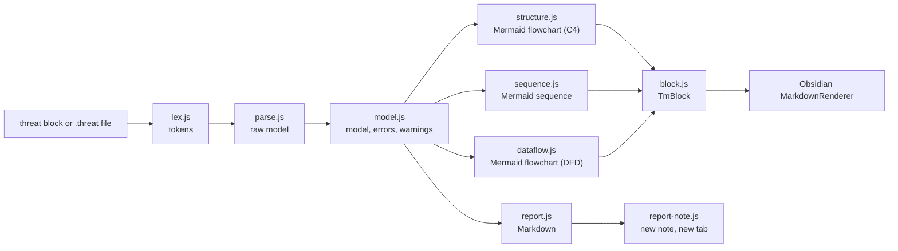

# Architecture



## Three layers

1. **The language** (`lex.js`, `parse.js`, `model.js`, `controls.js`, `risk.js`, `rules.js`, `tags.js`, `cvss.js`, `icons.js`) turns text into a plain model. No Obsidian, no DOM. `tmBuildModel(source)` returns `{ model, errors, warnings }`; errors and warnings carry the line they refer to (line 1 is the first line inside the code block).
2. **The views** (`structure.js`, `sequence.js`, `dataflow.js`, `report.js`) turn the model into text: Mermaid for the three diagrams, Markdown for the report. They are pure functions, so the tests check their output directly.
3. **Obsidian** (`plugin.js`, `block.js`, `file-view.js`, `report-note.js`, `settings.js`). `TmBlock` is a `MarkdownRenderChild`: it builds the model, draws the bar (a list of views, the level or scenario list, the switches and the Report button), and renders the chosen diagram by handing Obsidian's `MarkdownRenderer` a `mermaid` code block. Obsidian's Mermaid renderer (Pele, since Obsidian 1.15) draws it, in the current theme. The report is never shown in the block: its button saves it as a note and opens it in a new tab. Each render gets its own child `Component`, removed before the next, so nothing leaks when the view changes.
4. **Edits** (`edit.js`, `edit-threat.js`) change a model's text without disturbing the rest of it, for the point-and-click forms to come. The lexer gives every token its offsets in the text, and the parser records where each statement, its header (title and tags), its block and each attribute are (`.src`, `.attrSpans`). An edit parses the text, finds the item by a ref (`{ type: 'threat', id: 'T01' }`, `{ type: 'flow', n: 2 }`, …) and splices only the characters it must: a value where the value was, a new attribute on a line of its own in a block over several lines or beside the others in a block on one line (the user's layout is kept), a block made when there is none and taken away when it empties. `tmEditThreat` takes a form's fields and writes only what differs, in the style the threat already uses (a status as a tag or an attribute, STRIDE letters together or apart). Pure functions with no Obsidian or DOM, tested by `test/edit.test.mjs`, including adding and removing an attribute on every element and flow of every sample model and getting the same text back.
5. **The web app** (`src/web/`, built by `tools/build-web.mjs` into one page, `dist/web/index.html`) runs layers 1 and 2 and most of layer 3 unchanged. `shim.js` stands in for Obsidian: its helpers on DOM elements (`createEl`, `createDiv`, `empty`, …), `Component` and `MarkdownRenderChild`, a `MarkdownRenderer` that draws a `mermaid` block with Pele (bundled), `getIcon` from the bundled Lucide icons (old names too), `Notice`, and an `app` whose vault's only write is a download. So `TmBlock`, the threat register, the key, the STRIDE colouring, the icons and the report are the plugin's own code. Around them, `app.js` is the page (a `TmBlock` redrawn as you type, and beside it a highlighted editor using `tmHighlightInto`, which can be hidden), `menu.js` the models menu, `edit-panel.js` point and click (forms for elements, zones, flows and controls in `item-forms.js`, their edits in `item-edits.js`, kept in the web app until the plugin has the panel; a click on a box, zone or arrow, mapped back to the model through the diagram's IDs, or on a threat, opens a panel in the text's place with the threat form from `web/threat-form.js`; changes go through the edit engine and are refused if they would add an error), `store.js` keeps the user's models, their earlier versions and layout preferences in local storage, and `dialogs.js` asks for names and confirmations. New elements, flows and scenarios are written by `add-edits.js` and their forms are in `panel-more.js` (with the problems list). The text is `editor.js` (line numbers, jumping to a line or a statement), with the page's own undo history (`history.js`, as forms rewrite the text). `export.js` makes the share link (the model deflated into the address after `#`), pictures (the live SVG with its look written in; PNG through a canvas) and the register as CSV; `report-view.js` shows the plugin's report through `markdown.js` (a small Markdown reader that builds DOM) and prints it; `help.js` shows the language reference (`docs/language.md`, inlined at build time) and the shortcuts; `dropdown.js` is the top bar's small menus; `app-models.js` and `app-keys.js` add the menu's actions and the keyboard and click links to the page. Every overlay closes with Escape, a click outside it, or its close button. The page loads nothing from elsewhere: everything is inlined, and its Content-Security-Policy forbids connections.

## The model

```text
model
  title, description, defaultView, level, scenarioId
  elements[]  id, kind, role (external | process | store), title, description, technology, link, tags,
              extra (other attributes), parent, children[], zone, threats[], line
  zones[]     id, title, trust, description, tags, parent, threats[], line
  flows[]     n (1, 2, …), from, to, label, protocol, description, data[{ text, tags }], tags,
              threats[], crosses (zones differ), sensitive (#secret, #pii or #confidential data),
              encrypted, authenticated (true, false or null), line
  threats[]   id, title, tags, stride[], risk, method (rating | tag | cvss | score), likelihood, impact, rating,
              residual, residualLikelihood, residualImpact, residualRating, status, score, cvss, controls[],
              controlled, mitigation, description, owner,
              target { type: flow | element | zone | model }, where (text for the report), line
  scenarios[] id, title, steps[{ from, to, label, flow (n or null), line }], line
  controls[]  id, title, tags, status (planned | implemented | verified), owner, due, description, covers[], line
  findings[]  rule, risk, message, flow (n)
  meta        version, author, owner, status, reviewDate, scope, outOfScope[], assumptions[]
```

Two hierarchies are kept apart on purpose: `parent` (what an element is part of: drawn by the Structure view) and `zone` (where it runs: drawn by the Data flow and Sequence views). An element's zone is its own `zone =`, else the zone block it is written in, else its parent's.

## Decisions

- **Threats on the Structure view.** The overlay is part of `tmStructure`: a box gets the threats of everything hidden inside it at the current level (and of flows that start and end inside it), so the Context level still shows every threat somewhere. Boxes get a second class, `tmRisk<Risk>`, for their outline; arrows an ID starting `tm<risk>`, as in the Data flow view. `tmViewThreats` (threat-table.js) decides which threats each view's table lists; the key is `legend.js`.
- **A threat in several places** (`on`): the model keeps every place in `threat.targets` and adds the threat to each element's, zone's and flow's list; `threat.target` is the first, for code that needs one.

- **Syntax highlighting** (`highlight.js`) has its own small tokenizer rather than reusing the lexer: the lexer stops at the first mistake, but text being typed is full of them (an open string, half a keyword). It returns classed ranges, which three places turn into colour: a CodeMirror `ViewPlugin` with mark decorations for ```` ```threat ```` and ```` ```threat-source ```` blocks in the note editor, a Markdown post-processor for `threat-source` blocks in Reading view, and the `.threat` file editor, which is a textarea with transparent text over a highlighted `<pre>` (Obsidian has no public API for a CodeMirror editor in a custom view). The colours are the theme's `--code-*` variables.

- **Links to threats in a report.** Obsidian can't link to one row of a table, so the register is a list: each threat is a list item ending in a block ID (`^t01`), and every other mention is a link to it (`[[#^t01|T01]]`), which Page preview shows on hover. Threats without an ID get `^threat-<n>`.
- **The report is always a note** (`report-note.js`): an ordinary note, so Obsidian can print it or export it to PDF. Its diagrams are written with `{ portable: true }`: the report note is outside a `.tm-block`, so `styles.css` doesn't reach it, and fixed colours print the same in any theme. Reports go in a `Reports` folder beside the model's note unless a folder is chosen. A new report never replaces a note; it is numbered instead.

- **Mermaid only.** Obsidian ships a Mermaid renderer, so there is nothing to bundle and it works on mobile. The cost: less control over layout than Graphviz gave the old DataFlow tool (no ranking of external entities above processes above stores).
- **Pele, and colours from CSS.** Since 1.15, Obsidian draws Mermaid with [Pele](https://pele.run/), which themes diagrams with CSS variables; colours written into a diagram (`classDef`, `style`, `linkStyle`) stay fixed in light and dark mode. So the diagrams drawn in Obsidian only *name* things: a class per kind of node (`tmProc`, `tmContainer`…, which Pele puts on the node's `<g>`), and an edge ID that starts with the risk (`e4 tmcritical2@--> e5`, which Pele keeps as `data-id`). `styles.css` colours them from the theme's own colours through `--tm-*` variables. Zone and system boxes are styled through `.pele-cluster`. The sequence diagram's risk tints (`rect`) have no class to hang CSS on, so they stay written in, as see-through colours that work on any background.
- **Threat IDs as links.** `stride-colour.js` marks each known threat ID on a diagram (`data-tm-id`) and listens for clicks and hovers on the block or note section. In a threat block the IDs come from the model (`tmThreatIdInfo`, with a tooltip) and a click shows the threat's footprint (`tmShowFootprint`: the boxes, arrows and notes carrying its ID get `tm-hit`, the diagram `tm-focus`, and styles.css fades the rest) and brings the table row into view. In a saved report they come from its own threat register, read back from the note's text (`tmRegisterIndex`, which must match how `tmRegisterItem` writes it), and a click opens the register entry and a hover shows it through Obsidian's page preview. `id-links.js` holds both.
- **Findings.** `rules.js` works out whether each flow is encrypted (`encrypted`, else its protocol) and reads `authenticated`; `tmFindings` then applies a few fixed rules to the model's own facts and `tmBuildModel` stores the result as `model.findings`. The block lists them (`tmFindingsInto`), the report has a section for them, and the Structure and Data flow views draw unencrypted flows dashed (`-.->`).
- **Icons.** Pele draws no icons in labels, and Mermaid's icon shapes come out empty, as Obsidian gives Pele no icons. So `icons.js` turns `icon = "user"` into an empty first line in the node's label and class names on the node (`tmIcon_user`, `tmIconFg_x08427b`, `tmIconBg_white`; a `-` in a name becomes `_`, hex colours start with `x`, and each class gets a `classDef` that changes nothing so the class is kept), and once the diagram is drawn `icon-draw.js` puts Obsidian's own icon (`getIcon`) in that line, with `stride-colour.js`'s colouring, for blocks and for saved reports alike; that watches the block (or note section) with a `MutationObserver` for as long as it is shown, because Obsidian may draw a diagram only once it is scrolled into view, and may draw it again. In Live Preview Obsidian runs no post-processors on a note's own diagrams (a saved report's, say), so an editor extension (`diagram-editor.js`) watches the editor in the same way. Nothing is fetched. `tools/doc-images.mjs` draws the same icons from `lucide-static` when it is installed.
- **No notes over one participant.** Obsidian wraps sequence diagram text and ignores an `init` directive turning that off, so a note over one participant is squeezed to that participant's width. An element's own threats therefore go in a note across the step where it first appears (or across it and its neighbour), headed "On <element>:".
- **Coloured STRIDE letters.** Pele can't colour part of a label, so STRIDE letters are written as Unicode's boxed capitals (🆂 🆃 🆁 🅸 🅳 🅴: a filled box with the letter cut out). An SVG glyph takes its fill colour, so once a diagram is drawn `stride-colour.js` wraps each in a `<tspan class="tm-sg tm-sg-S">` and `styles.css` colours it from the theme: a coloured box with the letter in it. It runs for blocks after they render and, from a post-processor, for any note's diagrams (saved reports). Elsewhere (other Mermaid tools) they stay boxed letters in the text colour; the pictures in `docs/` get their colours written in. Tables and keys use HTML chips (`.tm-chip-S`). In the Sequence view, the risk word of an open threat is formatted more loudly as the risk rises (`<i>`, `<b>`, `<b><u>`, `<b><i><u>` in capitals), and `styles.css` colours each of those formattings, which Pele writes as `font-weight`, `font-style` and `text-decoration` on the `<tspan>`; only the risk word is ever formatted in a note. Threat IDs on boxes and arrows (`tmThreatMarks`, `tmThreatIdsText` in mermaid.js) get the same formatting by their risk (`tmRiskStyled`), at most four per label, and in a block `stride-colour.js` also wraps each known ID in a `<tspan class="tm-tid tm-tid-high">` (from `tmThreatIdClasses`) for its colour; a saved report has no model to hand, so its IDs keep only the formatting. The `rect` tint behind a note is fixed but see-through, stronger for higher risks.
- **Fixed colours for reports.** `tmStructure` and `tmDataflow` take `{ portable: true }` to write the colours into the diagram instead (`classDef` fills, `linkStyle`, no edge IDs). Saved reports use it, because they are ordinary notes outside a `.tm-block`, where `styles.css` doesn't reach; it also keeps their diagrams readable in any Mermaid tool.
- **Pele's labels** support line breaks, bold, italic, `<sub>` and `<sup>`, and Mermaid's entity codes; other HTML is dropped. That is why `tmMmText` keeps only those four tags. Edge IDs need Obsidian 1.15 (`minAppVersion`).
- **Mermaid IDs are generated** (`e1`, `z1`): model IDs may contain `-`, which Mermaid reads as part of an arrow.
- **The view each block shows is remembered** per note and model title while Obsidian runs, so editing a note doesn't send the block back to its first view.
- **STRIDE coverage gaps** use STRIDE per element: external entities S, R; processes S, T, R, I, D, E; data stores T, I, D; flows T, I, D. Only flows that cross a zone boundary, and processes that receive one, are checked, to keep the list short enough to act on.
