# The threat model language

A threat model is written in a `threat` code block in a note, or in a file ending `.threat`. One block holds one model. The plugin draws it three ways (Structure, Sequence and Data flow), writes a report of it as a note when you ask, and checks it as you write.

The language grew out of Sony's DataFlow (`.flow`) language, with ideas taken from [LikeC4](https://likec4.dev/): nesting, tags and named scenarios. It is not compatible with either.

## A first example

In a note, a model goes in a code block whose language is `threat`:

```threat
title = "Newsletter sign-up"

zone web "Public website" { trust = "untrusted" }

person visitor "Visitor" { zone = web }

system site "Marketing site" {
  container frontend "Web front end" { technology = "Next.js"  zone = web }
  store list "Mailing list" { technology = "PostgreSQL" }
}

visitor -> frontend "Submits the form" {
  protocol = "HTTPS"
  data = ["Email address #pii"]
}

frontend -> list "Stores the contact" {
  data = ["Email address #pii", "Time stamp"]
  threat T01 "SQL injection through the email field" #TI { likelihood = 3  impact = 4 }
}
```



The plugin draws it in the note, with a list to switch between the Structure, Sequence and Data flow views. Here, each complete example is followed by a picture of one of its views; in the sample vault's copy of this reference, each is shown as text and then drawn live, in place of the picture. Short fragments, which aren't whole models, are written as `threat-source` blocks.

To show a model's text in a note without drawing it, for example in documentation, use a `threat-source` code block: it is shown as text, highlighted the same way as while editing.

## Basics

| What | How |
| --- | --- |
| Comments | `// to the end of the line` or `/* across lines */` |
| Strings | `"one line"`, or backticks for several lines: `` `first line … last line` `` (leading spaces on each line are removed) |
| Numbers | `7.5`, `10` |
| Lists | `["Username", "Password #secret"]` |
| Attributes | `key = value`. Several can share a line: `technology = "Redis"  zone = dmz` |
| IDs | Letters, digits, `_` and `-`, starting with a letter, such as `auth_gateway` or `T-01`. Every ID in a model must be different, however deeply it is nested. |
| Hashtags | `#pii`, `#third-party`. See [Hashtags](#hashtags). |

Strings have no escape characters: a double-quoted string cannot contain `"`, so use a backtick string for text with quotation marks.

## Model attributes

Attributes at the top level describe the whole model and choose how it is shown:

| Attribute | Meaning |
| --- | --- |
| `title` | Shown above the diagrams, and names the report |
| `description` | Shown at the start of the report |
| `default_view` | The view to open with: `"structure"`, `"sequence"` or `"dataflow"`. Otherwise the plugin's setting applies. |
| `scenario` | The scenario the Sequence view opens with (its ID) |
| `level` | The C4 level the Structure view opens with: `"context"`, `"container"` or `"component"`. If the model has nothing that deep, its deepest level is used. |

These describe the model as a document, for the report (its properties, and its *Scope and method* section):

| Attribute | Meaning |
| --- | --- |
| `version`, `author`, `owner` | Who wrote it, who owns it, and which version it is |
| `status` | How far it has got: `"draft"` (the default), `"in-review"` or `"approved"` |
| `review_date` | When it should next be reviewed, such as `"2027-06-01"` |
| `scope` | What the model covers |
| `out_of_scope` | A list of what it deliberately leaves out |
| `assumptions` | A list of what it takes for granted, such as `["The cloud account is locked down"]` |

```threat-source
title = "Online shop"
version = "1.2"
owner = "Web team"
status = "in-review"
review_date = "2027-06-01"
scope = "The checkout, from the basket to the payment provider."
out_of_scope = ["The warehouse system", "Staff laptops"]
assumptions = ["The cloud account is locked down"]
```

## Elements

An element is written as **kind**, **ID**, an optional title and optional hashtags, then an optional block of attributes and nested elements:

```threat-source
container gateway "Auth Gateway" #auth {
  technology = "Node.js"
  zone = dmz
}
```

Without a title the ID is used. `title = "…"` inside the block works too.

Here is every kind in one model, with a system holding containers, and a container holding components:

```threat
title = "Every kind of element"

person shopper "Shopper"
external payments "Payment provider" { technology = "Stripe" }

system shop "Online shop" {
  container web "Storefront" { technology = "Next.js" }
  container orders "Orders service" {
    technology = "Java"
    component basket "Basket"
    component checkout "Checkout"
  }
  store db "Orders database" { technology = "PostgreSQL" }
  queue events "Order events" { technology = "Kafka" }
}

shopper -> web "Buys things"
web -> basket "Updates the basket"
web -> checkout "Checks out"
checkout -> payments "Takes payment"
checkout -> db "Saves the order"
checkout -> events "Order placed"
```



| Kind | Structure view (C4) | Data flow view | Can contain |
| --- | --- | --- | --- |
| `person` | Person | External entity | — |
| `external` | External system | External entity | — |
| `system` | Software system | Process (when it has nothing inside it) | containers, components, stores, queues |
| `container` | Container | Process | components, stores, queues |
| `component` | Component | Process | — |
| `store` | Database | Data store | — |
| `queue` | Queue | Data store | — |

The `.flow` format's names for kinds (`io`, `function`, `database`, and `boundary` for a zone) aren't part of this language: a model using one is told the word to write instead (`external`, `container`, `store`, `zone`).

Element attributes:

| Attribute | Meaning |
| --- | --- |
| `title`, `description` | Text shown on the diagrams and in the report |
| `technology` | For example `"PostgreSQL"`; shown on the Structure view |
| `zone` | The trust zone the element runs in (a zone ID) |
| `link` | A note, such as `"[[Customer Portal]]"`, or a web address; shown in the report |
| `icon` | An icon at the top of its box: see [Icons](#icons) |
| `icon_colour`, `icon_background` | The icon's colour and the colour of a square behind it (`icon_color` also works) |
| anything else | Kept and listed in the report |

Attributes can be separated by spaces, new lines or commas: `{ zone = web, icon = "user" }`.

### Icons

```threat
title = "Icons"

person visitor "Visitor" { icon = "user" }

system app "App" {
  container web "Web" { technology = "React"  icon = "globe" }
  container api "API" {
    technology = "Node.js"
    icon = "server"
    icon_colour = "#ffd166"
    icon_background = "#1d3557"
  }
  store db "Accounts" { technology = "PostgreSQL"  icon = "database" }
}

visitor -> web "Uses"
web -> api "Calls"
api -> db "Reads"
```



`icon` names an icon from [Lucide](https://lucide.dev/icons), the icon set Obsidian uses, such as `"user"`, `"users"`, `"database"`, `"server"`, `"globe"`, `"smartphone"`, `"shield"`, `"lock"`, `"key"`, `"mail"` or `"cloud"`. Write it in quotes. The icon sits above the element's name in the Structure and Data flow views, in the colour of the box's text unless `icon_colour` gives one; `icon_background` puts it on a rounded square of that colour. Colours are written as `"#08427b"` or as a name such as `"white"`.

An element that doesn't name an icon gets a default one:

- A `person` is always `user`.
- Otherwise its `technology` decides, when a word in it is known:

  | Technology (any of these words) | Icon |
  |---|---|
  | iOS, Android, Xamarin, React Native, Flutter, mobile | `smartphone` |
  | Kafka, RabbitMQ, SQS, SNS, Service Bus, Event Hubs, MQTT, queue | `list-ordered` |
  | PostgreSQL, MySQL, MariaDB, SQL Server, Oracle, MongoDB, Redis, DynamoDB, Cosmos DB, SQLite, database | `database` |
  | S3, Blob storage, object storage, file share, files, SharePoint | `archive` |
  | email, SMTP, IMAP, Exchange | `mail` |
  | LDAP, Active Directory, Entra ID, IdP, OAuth, OpenID Connect, SAML, Keycloak, Okta, Auth0 | `key-round` |
  | React, Angular, Vue, Svelte, web, SPA, HTML, JavaScript, TypeScript, browser | `globe` |
  | Node.js, Java, .NET, ASP.NET, C#, Go, Python, Django, Spring, Ruby, PHP, API, REST, gRPC | `server` |

  The first row that matches wins, so "React Native" is a phone, not a web page.
- Otherwise its kind decides: `external` is `building-2`, `store` is `database` and `queue` is `list-ordered`.

Systems, containers and components have no default of their own, as they vary too much for one icon to say anything. If you want one, these work well: `container` (the shipping container) or `boxes` for a system, `app-window` or `server` for a container, and `puzzle` for a component.

`icon_colour` and `icon_background` colour a default icon too. `icon = "none"` leaves the icon off one element, and the *Default icons* setting leaves all the defaults off (icons the model names are still drawn).

Font Awesome names such as `"fa:fa-user"`, used on Mermaid's own site, don't work: Obsidian doesn't have those icons, and the plugin never fetches anything from the internet. The model warns about one and suggests the Lucide name where there is an obvious one. A name Obsidian doesn't know shows as a red "?"; hover over it to see the name.

Icons are drawn on the boxes that aren't opened up: a system or container shown as a box around its contents has none. In a saved report they show in Obsidian (and in a PDF exported from it); in other Mermaid tools the box just has an empty first line.

### Nesting is about what an element is part of

Nesting an element inside a `system` or `container` says it is part of it, as in C4. The Structure view draws the nesting; the Data flow view ignores it.

## Zones (trust boundaries)

A zone is a trust boundary: an area where everything is trusted to the same degree, such as the internet, a DMZ or a cloud account. The Data flow view draws zones as boxes, with a warning shield (`shield-alert`) after the title of a zone whose `trust` says untrusted. The Structure view draws them too, as dotted boxes within each level: at the top, and inside each system or container, the boxes in a zone other than the one around them are put in a zone box, so a zone split across two systems is drawn in each (its *Zones* switch hides them); the Sequence view groups participants by zone; the report lists every flow that crosses from one zone to another.

There are two ways to put an element in a zone, and you can mix them:

```threat
// 1. nest it inside the zone (simple models)
zone dmz "Corporate DMZ" { trust = "restricted"
  container gateway "Auth Gateway"
}

// 2. name the zone with an attribute (when the element is nested in a system)
zone internet "Internet" { trust = "untrusted" }
system portal "Customer Portal" {
  container webapp "Web App" { zone = internet }
}

webapp -> gateway "Signs in"
```



An element without a zone takes its parent's zone. `trust` is free text, shown on the Data flow view and in the report.

Zones can be nested inside zones, for a boundary inside a boundary, such as two regions of one cloud account:

```threat
zone internet "Internet" { trust = "untrusted" }
zone aws "AWS (private)" { trust = "restricted"
  zone west1 "us-west-1" {
    container api "API"
    store db1 "Orders"
  }
  zone west2 "us-west-2" {
    store db2 "Orders replica"
  }
}
person user "Customer" { zone = internet }

user -> api "Places an order" { protocol = "HTTPS" }
db1 -> db2 "Replicates" { protocol = "TLS"  data = ["Orders #pii"] }
```

A flow between two elements in different zones crosses a zone boundary. When both ends are inside the same outer zone (*Replicates*, between the regions but inside AWS), the crossing stays inside that zone: its findings are a step less serious than those of a flow going out of or into a zone altogether (*Places an order*), say which zone it stays inside, and the report lists such flows after the others, with the zone in a *Stays inside* column.

## Flows

A flow is data moving from one element to another:

```threat
container webapp "Web App"
container gateway "Auth Gateway"

webapp -> gateway "POST /login" #auth {
  protocol = "HTTPS"
  data = ["Username", "Password #secret"]
  description = `The browser posts the login form.`
  threat T01 "Credential stuffing on the login form" #S #critical
}
```



`a <- b` is the same as `b -> a`. There is no two-way arrow: each direction usually carries different data and different threats, so write each one.

| Attribute | Meaning |
| --- | --- |
| `label` | The flow's label, if not given after the arrow (`operation` also works, as in `.flow`) |
| `protocol` | For example `"HTTPS"` or `"OIDC"` (`technology` also works) |
| `encrypted` | `true` or `false`. Without it, the protocol decides: HTTPS, TLS, SSH, OIDC and the like are encrypted; HTTP, FTP, Telnet and the like aren't; anything else isn't known. An unencrypted flow is drawn dashed. |
| `authenticated` | `true` or `false`; not known unless written |
| `data` | What is sent: a string or a list of strings; hashtags classify each item |
| `description` | Shown in the report |

Flows can be written anywhere: at the top level, or inside an element's block.

## Threats

```threat-source
threat T03 "Redis reachable without authentication" #E #I {
  likelihood = "possible"
  impact = "major"
  status = "open"
  mitigation = "Set requirepass and bind to the private network only"
  owner = "Platform team"
}
```

A threat is `threat`, an optional ID, a title, hashtags, then an optional block. Where it is written says what it is about:

- inside a flow's block: that flow
- inside an element's or zone's block: that element or zone
- at the top level: the whole model

To put one threat in several places, list them with `on`. Elements and zones are named by their IDs, flows as `a -> b` (add the label to choose between flows that join the same two elements; without it, all of them are meant). A threat written inside a block is about that block too.

```threat-source
threat R3 "Traffic inside the VM isn't encrypted" #TI #medium {
  on = [proxy -> launcher, proxy -> cards, proxy -> api "Upload"]
  mitigation = "Everything runs on one VM; revisit if it's split"
}
```

| Part | Meaning |
| --- | --- |
| ID | Optional but recommended: the report warns about threats without one. IDs are what let you track a threat over time. |
| STRIDE hashtags | `#S` spoofing, `#T` tampering, `#R` repudiation, `#I` information disclosure, `#D` denial of service, `#E` elevation of privilege. Letters can be combined in one tag, in any order: `#STR` is the same as `#S #T #R`, and `#IE` as `#I #E`. The long words work too (`#spoofing`). |
| Risk hashtag | `#critical`, `#high`, `#medium` or `#low`: a quick rating, when you don't give likelihood and impact |
| Status hashtag | `#open` (the default), `#mitigated`, `#accepted` or `#transferred`; `status = "…"` does the same. Anything but open is closed: dealt with by a fix (mitigated), a decision to live with it (accepted) or someone else carrying it (transferred). Closed threats colour nothing on the diagrams, their IDs are struck through, and the report lists them briefly after the open ones. |
| `cvss` | For a threat that is a known vulnerability: its CVSS 3.0 or 3.1 vector, such as `"CVSS:3.1/AV:N/AC:L/PR:N/UI:N/S:U/C:H/I:H/A:H"`. The score is worked out from it and gives the risk. The threat register's tooltip and the report explain the score (where it sits on CVSS's own scale: 7.0 to 8.9 is high, and so on) and the vector in words ("Attack vector: network · …"), and link to FIRST's CVSS calculator with the vector filled in. |
| `on` | Other elements, zones and flows the threat is about: see above |
| `likelihood`, `impact` | The main way to rate a threat: each 1 to 5, or a word: likelihood `rare`, `unlikely`, `possible`, `likely`, `almost-certain`; impact `negligible`, `minor`, `moderate`, `major`, `severe`. See below |
| `residual_likelihood`, `residual_impact` | The likelihood and impact once the threat's controls are in place; give either, and the other is the threat's own |
| `residual` | The risk once controls are in place, as a word (`"low"`), when you don't rate it |
| `controls` | The controls that deal with it, by ID: see [Controls](#controls) |
| `mitigation`, `description`, `owner` | Shown in the report |

Rate each threat one way:

- **Likelihood × impact** (the main way): from 1 to 25, where 20 and over is critical, 10 high, 5 medium and anything less low. It suits design threats, and has an "after controls" form.
- **A risk hashtag** (`#high`): a quick rating when you don't want to weigh likelihood and impact.
- **A CVSS vector** (`cvss = "…"`): only for a threat that is a known vulnerability, such as a library with a published CVE. CVSS was made for scoring vulnerabilities, not design threats. Its score gives the risk: 9.0 and above is critical, 7.0 high, 4.0 medium, anything else low.

A threat rated more than one way gets a warning, and the first in that list is used. (`score = …`, from the original DataFlow format, is still read but warned about: give likelihood and impact instead.)

The threat register under each diagram shows how each threat is rated ("4 × 5 = 20" or "CVSS 6.1"); hover over it to see what the numbers mean. A CVSS rating's tooltip says what the score means on CVSS's scale (none, low 0.1 to 3.9, medium 4.0 to 6.9, high 7.0 to 8.9, critical 9.0 to 10.0) and spells out the vector; the rating is also a link to FIRST's CVSS calculator (FIRST publishes CVSS), with its vector filled in, to see or change it; the vector goes after a `#`, which browsers don't send to the website. Diagrams show the same after each threat ID: `T01 (4×5)` or `T04 (6.1)`.

With a residual likelihood or impact too, the threat has a risk before and after its controls:

```threat-source
threat T01 "Credential stuffing on the login form" #S {
  likelihood = "likely"     // 4
  impact = "severe"         // 5: 4 × 5 = 20, critical
  residual_likelihood = 2   // with rate limiting: 2 × 5 = 10, high
  controls = [C01]
}
```

The threat register under each diagram shows both risks ("Critical → High") and the likelihood × impact. The report places the open threats on a risk matrix, once as assessed and once after controls, and its summary counts the open threats by the risk left after controls. Diagrams colour threats by the risk as assessed.

## Controls

A threat says what could go wrong; a control says what is done about it. One control often covers several threats, and each has a status, so the model shows which threats are dealt with and which are still waiting:

```threat-source
control C01 "Mutual TLS between services" #implemented {
  covers = [T01, T02]
  owner = "Platform team"
  due = "2026-12-31"
}

control C02 "Short-lived session tokens" { covers = T01 }
```

A control is `control`, an ID (needed, so threats can name it), a title, hashtags, then an optional block. Controls are written at the top level. The link to threats can be written on either side: `covers = [...]` on the control, or `controls = [C02]` on a threat; either way both know about it.

| Part | Meaning |
| --- | --- |
| Status hashtag | `#planned` (the default), `#implemented` or `#verified`; `status = "…"` does the same |
| `covers` | The threats it deals with, by ID |
| `owner`, `due` | Who is doing it and by when; shown in the report |
| `description` | Shown in the report |

An open threat's status in the threat register under each diagram shows its progress ("Open · 1 of 2 controls in place"). When all of an open threat's controls are implemented or verified, the model reminds you to set its status to mitigated if that deals with it; the plugin never closes a threat itself, as only a person can judge whether the controls are enough.

A threat's own `mitigation = "…"` still works for a quick note. Controls add what a mitigation can't: one fix shared by several threats, its progress, and who owns it. The threat register under each diagram lists a threat's controls with its mitigation. The report lists each threat's controls in the register, has a section for the controls themselves (planned first), and says in its summary how many open threats have a control in place and which have nothing at all.

## Scenarios

The model itself has no order: flows are a list of what talks to what. A scenario is an ordered walk through some of those flows, drawn by the Sequence view:

```threat
person customer "Customer"
container webapp "Web App"
container gateway "Auth Gateway"
store sessions "Session Store" {
  threat T03 "Redis reachable without authentication" #IE #high
}

customer -> webapp "Enters credentials"
webapp -> gateway "POST /login" {
  data = ["Username", "Password #secret"]
  threat T01 "Credential stuffing on the login form" #S #critical
}
gateway -> sessions "Create session"
gateway -> webapp "Set session cookie" { data = ["Session ID #secret"] }
gateway -> webapp "Error page"

scenario login "Customer signs in" {
  customer -> webapp
  webapp -> gateway
  gateway -> sessions
  gateway -> webapp "Set session cookie"
}
```



Each step finds the flow between those two elements and takes its label, data and threats. When there is more than one flow between them, add the label to choose. A step that matches no flow is still drawn, as a dashed arrow, with a warning.

Without a scenario, the Sequence view shows every flow in the order written, as `.flow` did.

## Hashtags

Hashtags can follow any title (element, zone, flow or threat) and can appear inside any string, such as a description or a `data` item. Either way they become tags on that item, and they stay in the text where you wrote them.

Some tags mean something to the plugin:

| Tags | Meaning |
| --- | --- |
| `#S #T #R #I #D #E`, combined (`#STR`, `#IE`) and the long forms | STRIDE categories, on threats. A tag made only of the capitals S, T, R, I, D and E always means STRIDE, so don't use one such as `#DR` for anything else. |
| `#critical #high #medium #low` | Risk, on threats |
| `#open #mitigated #accepted #transferred` | Status, on threats |
| `#planned #implemented #verified` | Status, on controls |
| `#secret #pii #confidential` | Sensitive data: marked with a padlock (🔒) in the Data flow view, and the report lists every flow that carries it across a zone boundary |
| `#public` | Data that is not sensitive |

Every other tag is yours, such as `#third-party`, `#legacy` or `#payments`.

## The views and the report

| View | Drawn as | Grouped by | Notes |
| --- | --- | --- | --- |
| **Structure** | Mermaid flowchart in C4 style | systems and containers | The level list switches between *Context* (people, systems and external systems), *Container* (inside each system) and *Component* (everything). Flows are shown between the elements visible at that level. Zones are drawn as dotted boxes within each level, unless the *Zones* switch is off. With the *Threats* switch on (the default), boxes and arrows carry the coloured STRIDE letters and their threat IDs, and are outlined or coloured by their most serious open threat; threats on hidden elements, and on flows hidden inside a box, show on that box. The list offers only the levels that show something different: *Container* when a system has something inside it, *Component* when a container does; with nothing nested there is no level list. |
| **Sequence** | Mermaid sequence diagram | zones | A list chooses the scenario. Threats are notes: a flow's across that flow, an element's across the step where it first takes part, headed with its name. Each STRIDE letter is in a box of its own colour, the risk of an open threat louder as it rises (italic, bold, underlined, then capitals) and coloured, and a tint behind the note that strengthens with the risk. |
| **Data flow** | Mermaid flowchart | zones (trust boundaries) | External entities are grey boxes, processes blue circles and stores red cylinders. Flows are numbered, with STRIDE letters (each in its coloured box) and threat IDs, and coloured by their most serious open risk. Sensitive data has a padlock (🔒) and an untrusted zone a warning shield, unless *Default icons* is off. |
| **Report ↗** | A new note, opened in a new tab | — | Not a view: a summary (top risks and what needs doing), scope and method, the threat register, controls, an action plan by owner, findings from the model, a risk matrix, the diagrams, flows crossing zones, sensitive data crossing zones, gaps in STRIDE coverage, elements and flows, saved as a note ready to print or export to PDF. |

Under each diagram is its threat register: the threats it shows (threats about the whole model are in every one), then a key to its colours. The threat IDs on boxes and arrows match the register's first column, so each mark on the diagram can be looked up (hover over an ID to see its threat; click it to fade everything the threat doesn't apply to and bring its row in the register into view, and click again to clear); a threat's rating follows its ID in brackets: `T01 (4×5)` for likelihood × impact, `T04 (6.1)` for a CVSS score. They are listed most serious first, at most four to a box or arrow (then "+2" and so on), and an open threat's ID gets louder as its risk rises, as the risk word does in the Sequence view (italic, bold, underlined) and in its risk colour; closed threats' IDs are plain. The *Compact* switch shortens labels (no descriptions or data; a flow's number in the Data flow view) and leaves the detail to the table.

## Findings from the model

Some risks follow from facts the model already holds, whether or not anyone has written a threat for them. The plugin checks for these and lists them under the threat register (*Findings from the model*) and in the report, with a line in its *Needs action* summary:

| Finding | Risk |
| --- | --- |
| Sensitive data (`#secret`, `#pii`, `#confidential`) on a flow that isn't encrypted | High across a zone boundary, otherwise medium (also medium between zones that are both inside another zone) |
| Sensitive data crossing a zone boundary on a flow whose encryption isn't known | Low: give it a `protocol`, or `encrypted = true` or `false` |
| A flow marked `authenticated = false` that crosses a zone boundary or writes to a store | High across a boundary, otherwise medium (also medium between zones that are both inside another zone) |
| A store written straight from a zone whose `trust` says untrusted, with no process in between | Medium |

They are prompts, not threats: write a threat (and a control) for each that matters, or set `encrypted` or `authenticated` where the model doesn't say.

## Checks

These stop the model being drawn, and are shown with their line numbers:

- a syntax error
- two elements, zones, scenarios, threats or controls with the same ID, or a control with a threat's ID
- a flow, `zone =`, `on =`, `covers =`, `controls =` or scenario step naming an ID that doesn't exist, or `on =` naming a flow there isn't
- a control inside a block, or without an ID
- an element nested where it can't be (for example inside a `store`)
- a kind name from the `.flow` format (`io`, `function`, `database`, `boundary`): the message says the word to use

These are shown as warnings under the diagram (unless the *Show warnings* setting is off) and at the end of the report:

- a threat without an ID
- a threat with no STRIDE category
- a scenario step that matches no flow
- a threat rated more than one way (a risk tag, likelihood × impact, a CVSS vector): the first is used
- a `score` (no longer used to rate threats), or one outside 0–10
- a CVSS vector that can't be read, including CVSS 4.0 vectors, which aren't supported yet
- a `status` that isn't `open`, `mitigated`, `accepted` or `transferred` (on a control: `planned`, `implemented` or `verified`)
- a control that covers no threat
- `encrypted` or `authenticated` set to something other than `true` or `false`
- a `default_view`, `level` or `status` that isn't one of the allowed values, or a `scenario` that names no scenario

## Grammar

```text
model      = { statement } ;
statement  = attribute | element | zone | flow | threat | control | scenario ;
attribute  = ID "=" value ;
value      = STRING | NUMBER | ID | TAG | "[" [ value { "," value } [ "," ] ] "]" ;
element    = KIND ID [ STRING ] { TAG } [ "{" { statement } "}" ] ;
zone       = "zone" ID [ STRING ] { TAG } [ "{" { statement } "}" ] ;
flow       = ID ( "->" | "<-" ) ID [ STRING ] { TAG } [ "{" { statement } "}" ] ;
threat     = "threat" [ ID ] STRING { TAG } [ "{" { attribute } "}" ] ;
control    = "control" ID STRING { TAG } [ "{" { attribute } "}" ] ;   (top level only)
scenario   = "scenario" ID [ STRING ] { TAG } "{" { attribute | step } "}" ;
step       = ID ( "->" | "<-" ) ID [ STRING ] ;
KIND       = "person" | "external" | "system" | "container" | "component" | "store" | "queue" ;
```

Inside a flow's block only attributes and threats are allowed; inside a threat's or control's block, only attributes.
